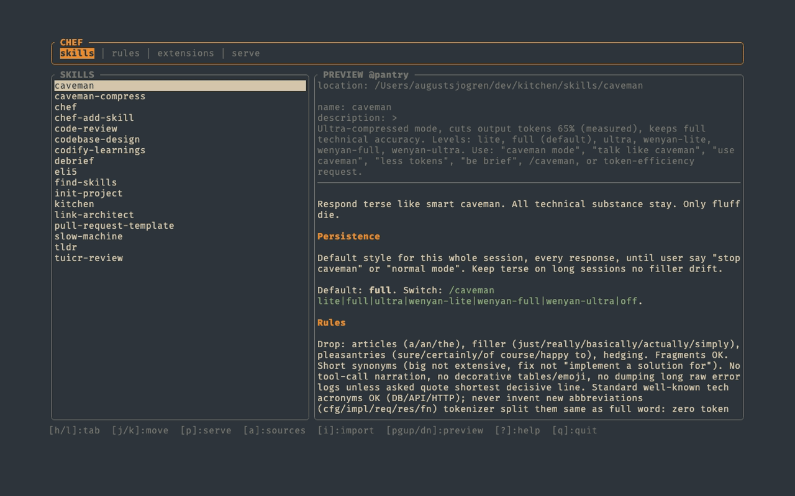
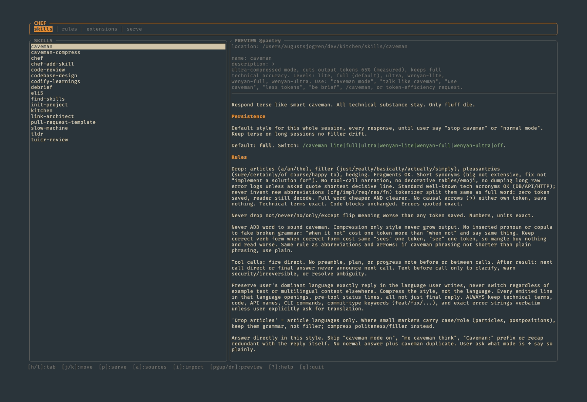
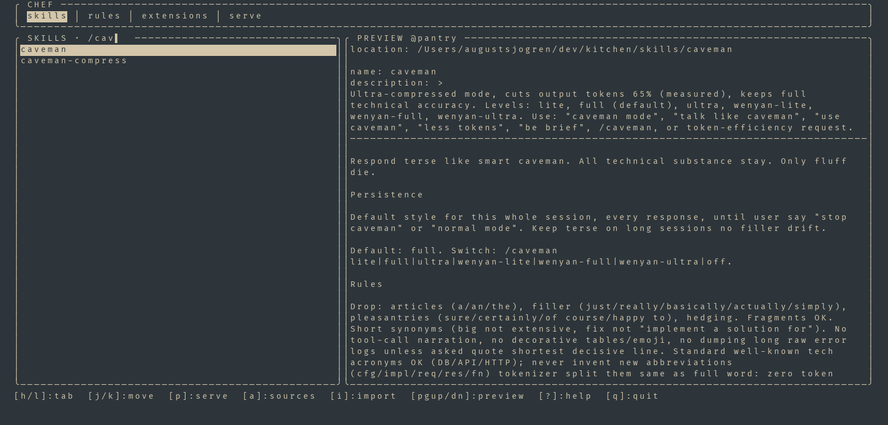
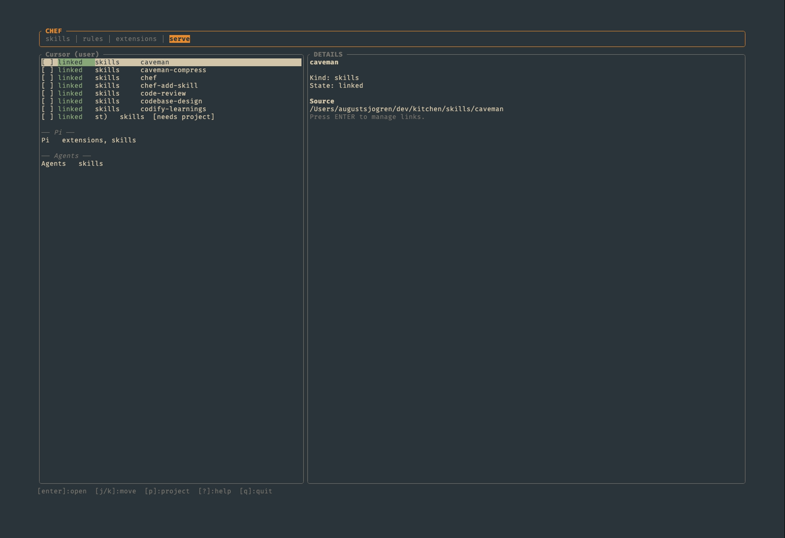
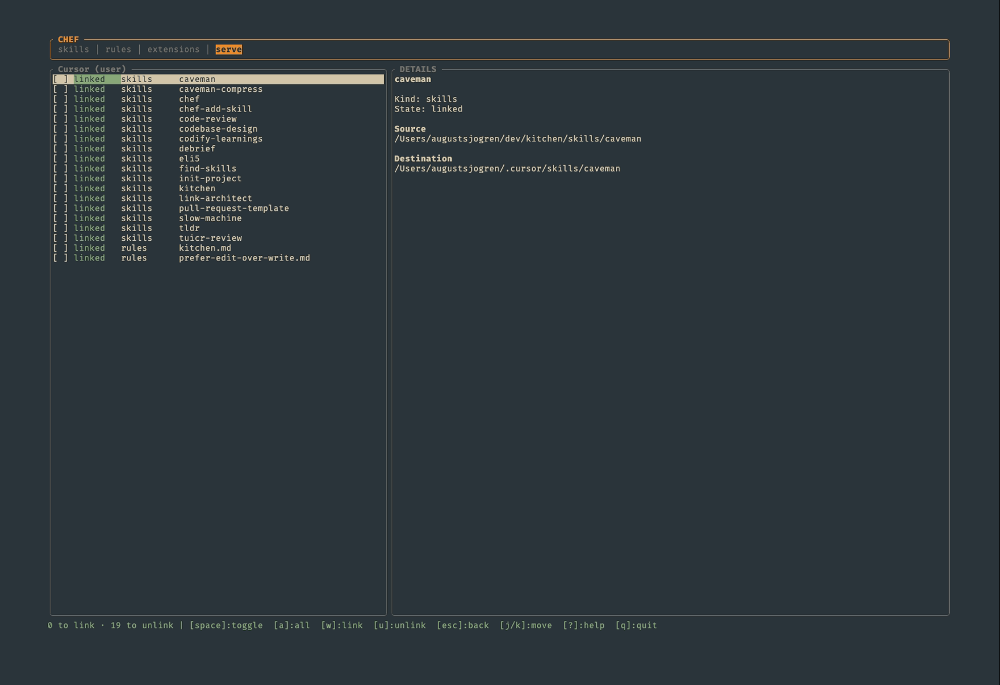
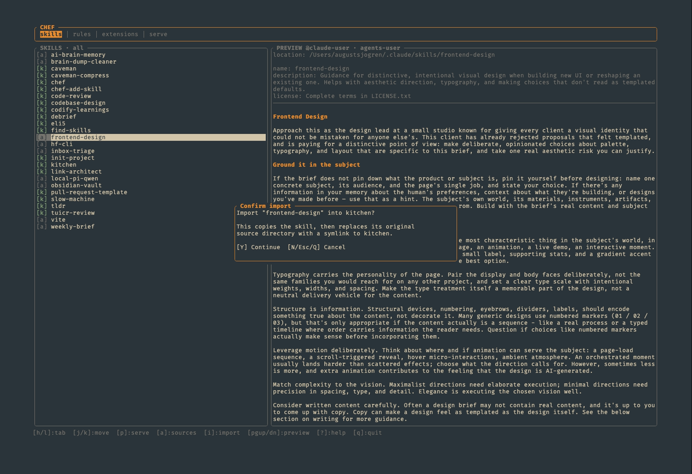
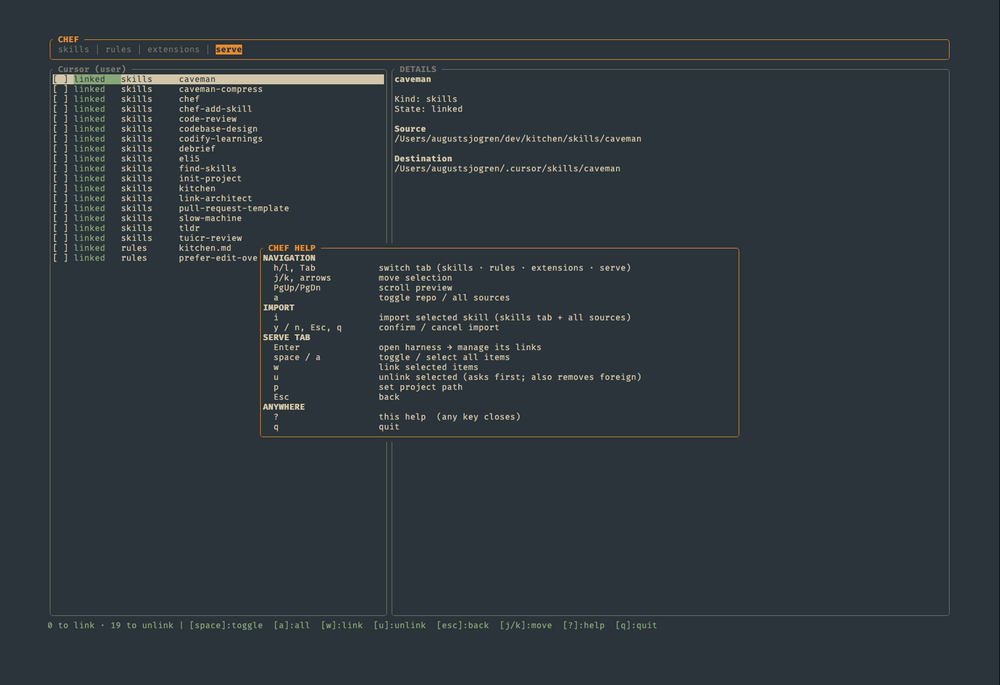

# chef

*Skills in, good code out.*

<p align="center">
  
</p>

`chef` is a Rust CLI/TUI for keeping AI agent skills in one place and linking them into the coding tools that use them. It is less “enterprise platform” and more “small kitchen where the mise en place is unusually well organized.”

This repository is a personal project shared as a showcase, not a supported general-purpose product. It runs on **macOS and Linux**; Windows is not supported because linking relies on Unix symlinks.

## How it works

- **Kitchen:** your own folder of skills, rules, and extensions. It is the single source of truth, and it does not live in this repository. See [KITCHEN.md](KITCHEN.md).
- **Harnesses:** the tools that load skills, such as Cursor, Claude, Pi, or anything reading `~/.agents/skills`. Each one is described in [`harnesses/targets.json`](harnesses/targets.json).
- **Serving:** `chef` symlinks kitchen items into each harness's directory. Edit a skill once in the kitchen and every harness sees the change.

## Requirements

- macOS or Linux
- A kitchen: any folder with a `skills/` directory
- To build from source: Git, plus Rust and Cargo ([install Rust with rustup](https://rustup.rs/))

## Install

### Prebuilt binary

Download the archive for your platform from the [latest release](https://github.com/augustsjogren/chef/releases/latest), then put `chef` on your `PATH`:

| Platform | Archive |
|---|---|
| macOS, Apple Silicon | `chef-<version>-aarch64-apple-darwin.tar.gz` |
| macOS, Intel | `chef-<version>-x86_64-apple-darwin.tar.gz` |
| Linux, x86_64 | `chef-<version>-x86_64-unknown-linux-gnu.tar.gz` |
| Linux, ARM64 | `chef-<version>-aarch64-unknown-linux-gnu.tar.gz` |

```bash
tar -xzf chef-<version>-<target>.tar.gz
install -m 755 chef-<version>-<target>/chef ~/.local/bin/chef   # any directory on your PATH
```

Each archive has a matching `.sha256` file. The binaries are not signed: if macOS blocks a browser-downloaded binary, run `xattr -d com.apple.quarantine ~/.local/bin/chef`.

### From source

Put on your terminal apron, clone this repository, and run the installer:

```bash
git clone https://github.com/augustsjogren/chef.git
cd chef
./install
```

The installer builds `chef`, installs it through Cargo, and adds Cargo's bin directory to your shell startup file when needed. It does not install Rust or modify system packages. Use `./install --dry-run` to preview, or `--no-shell-modification` to leave your shell profile alone.

Later, `chef update` pulls the clone, reinstalls `chef`, and refreshes its bundled skills. Run it after local changes too.

## Quick start

Create a kitchen, or point `CHEF_KITCHEN` at a folder you already have:

```bash
mkdir -p ~/kitchen/skills
```

Find the id of the harness you use, then link chef's own skills into it:

```bash
chef serve harnesses
chef bootstrap --harness <id>
```

This links two bundled skills: `chef`, which teaches your agent how to use this tool, and `chef-add-skill`, which turns a solved problem into a new skill. Without `--harness`, bootstrap targets `cursor-user`.

Then open the TUI:

```bash
chef
```

Browse what you already have, import existing skills into the kitchen with `i`, and link them into a harness from the **serve** tab. See [the TUI](#the-browse-tui) below; every step also has a [CLI command](#commands) for scripts and agents.

Want to look around first? Browse the sample kitchen in this repository:

```bash
CHEF_KITCHEN="$PWD/testdata/pantry" chef
```

## The browse TUI

<p align="center">
  
  
</p>
<p align="center">
  
  
</p>
<p align="center">
  
  
</p>

One screen, four tabs: **skills · rules · extensions · serve**. Press `?` for the full key list.

- **Browse:** `h/l` or `Tab` switch tabs, `j/k` move, `PgUp/PgDn` scroll the preview. `a` toggles between the kitchen only and all sources (kitchen plus every harness directory on this machine).
- **Filter:** `/` narrows the list as you type; `Esc` clears it.
- **Import:** `i` on an external skill (skills tab, all sources) copies it into the kitchen and replaces the original with a symlink, after a `Y/N` confirmation.
- **Serve:** pick a harness with `Enter`, select items with `space` or `a`, then `w` links and `u` unlinks the selection. The status row shows what will happen (`2 to link · 1 to unlink`), and unlinking always asks first.
- **Link status:** `linked`, `unlinked`, `foreign` (points somewhere else; unlink and relink with `w` to heal it), or `blocked` (a real file sits at the destination, and chef won't overwrite it).
- `q` quits.

For scripts and agents, use the CLI below: `chef serve` never opens a screen.

## Commands

Running `chef` without a subcommand opens the browse TUI. No reservation required.

| Command | What |
|---|---|
| `chef` / `chef pantry` | Browse kitchen and harness content in one TUI |
| `chef status` | Print kitchen counts |
| `chef import <name> --keep-source` | Copy an external skill into the kitchen and keep the original |
| `chef import <name> --force` | Copy it in and replace the original with a symlink |
| `chef bootstrap [--harness <id>]` | Link the bundled `chef` and `chef-add-skill` skills into a harness |
| `chef serve` | Print link status for every harness (same as `chef serve status`) |
| `chef serve harnesses` | List harness ids |
| `chef serve link <id>` / `unlink <id>` | Link or unlink the kitchen in one harness |
| `chef serve sync [<id>…]` | Link several harnesses in one pass |
| `chef serve --dry-run …` | Preview changes without touching harness directories |
| `chef update` | Pull this repository, reinstall `chef`, and refresh the bundled skills (clone installs only) |

Project harnesses (`cursor-project`, `claude-project`) also need `--project <path>`. Run `chef <command> --help` for every option.

A typical service, with your own counts and paths:

```text
$ chef status
skills 17  rules 2  extensions 1

$ chef serve --dry-run link claude-user
skills/caveman: would link → /Users/you/.claude/skills/caveman
…

$ chef serve
Claude (user) (claude-user)
  skills/caveman            linked     /Users/you/.claude/skills/caveman
  skills/chef               linked     /Users/you/.claude/skills/chef
  …
```

## Harnesses

| Id | Skills | Rules | Extensions |
|---|---|---|---|
| `cursor-user` | `~/.cursor/skills` | `~/.cursor/rules` | |
| `claude-user` | `~/.claude/skills` | | |
| `pi` | `~/.pi/agent/skills` | | `~/.pi/agent/extensions` |
| `agents` | `~/.agents/skills` | | |
| `cursor-project` | `<project>/.cursor/skills` | `<project>/.cursor/rules` | |
| `claude-project` | `<project>/.claude/skills` | | |

These match one developer's machine. To add or change a harness, edit [`harnesses/targets.json`](harnesses/targets.json) and run `chef update`. `chef` is intentionally opinionated: it has a favorite knife and strong feelings about mise en place.

## Configuration

| Variable | Default | Purpose |
|---|---|---|
| `CHEF_KITCHEN` | `~/kitchen` | Kitchen location |

## Troubleshooting

- **`chef` not found after installing:** open a new shell or source your shell profile.
- **"no kitchen at …":** create a `skills/` folder there, or set `CHEF_KITCHEN` to a folder that has one.
- **Links fail:** check that the harness directory is writable. Items shown as `blocked` have a real file in the way; move it aside first.
- **`chef import` refuses:** pass `--keep-source` to keep the original, or `--force` to replace it with a symlink.

## Development

```bash
cargo fmt --check
cargo clippy -- -D warnings
cargo test
```

`./dev <args>` runs `chef` from source without reinstalling. This project is not accepting contributions; see [CONTRIBUTING.md](CONTRIBUTING.md).

<p align="center">
  
</p>

## License

MIT. See [LICENSE](LICENSE).
